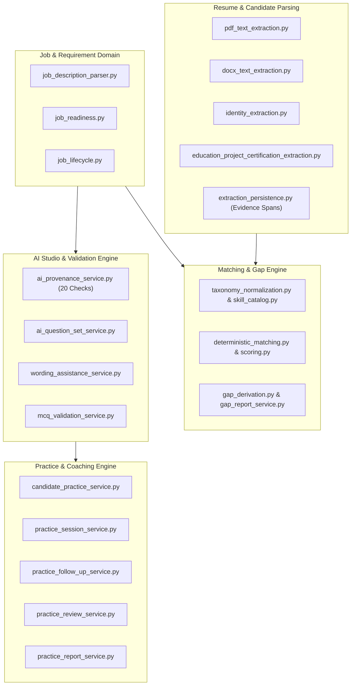

# AI-Hiring Platform: Backend Domain Services & API Reference
**Document Version:** 1.0.0  
**Framework:** FastAPI 0.115+ | SQLAlchemy 2.0 (PostgreSQL 16) | Pydantic v2  
**Coverage:** 60+ Domain Services, RESTful Route Hierarchy, Auth Contracts, Provenance Engines & Error Handling

---

## 1. Authentication & Security Architecture

### 1.1 Session & Middleware Pipeline
1. **Double-Submit CSRF Protection (`set_csrf_cookie`, `verify_csrf_token`)**:
   - `GET` requests generate a cryptographically signed HMAC token in memory.
   - All state-changing requests (`POST`, `PUT`, `PATCH`, `DELETE`) require header `X-CSRF-Token` matching the active session cookie.
2. **HttpOnly Cookie Authentication**:
   - Session identifier stored securely in `session_id` cookie with flags: `HttpOnly=True`, `SameSite=Lax` (or `Strict`), `Secure=True` in production.
3. **Role-Based Access Control (RBAC)**:
   - `require_admin`: Verifies `user.role == "ADMIN"`.
   - `require_recruiter`: Verifies `user.role in ("ADMIN", "RECRUITER")`.
   - `require_candidate`: Verifies `user.role == "CANDIDATE"` and active candidate account binding record.

---

## 2. API Endpoint Directory

### 2.1 Candidate Access & Invitations (`/api/v1/candidates`)
- `POST /invitations`: Creates single-use candidate magic-link invitations.
- `POST /auth/activate`: Exchanges magic token for candidate credentials and binds user account to `CandidateIdentityRecord`.
- `POST /auth/login`: Candidate authentication endpoint returning session cookie.
- `GET /auth/me`: Returns active candidate profile and bound candidate identity.

### 2.2 Job Requisitions & Requirements (`/api/v1/jobs`)
- `GET /`: Lists all accessible requisitions for the recruiter/admin organization.
- `POST /`: Creates a draft requisition and initializes Revision #1.
- `GET /{job_id}`: Retrieves full job requisition hierarchy with all version snapshots.
- `POST /{job_id}/versions`: Creates a new immutable job revision.
- `POST /{job_id}/versions/{version_id}/requirements`: Bulk creates/updates grounded requirements.
- `POST /{job_id}/versions/{version_id}/mark-ready`: Transitions version status to `READY_FOR_MATCHING` after readiness checks.

### 2.3 Deterministic Matching & Gap Analysis (`/api/v1/match-runs`)
- `POST /`: Triggers an auditable match run between a job revision and selected candidates.
- `GET /{match_run_id}`: Returns deterministic ranking scores, breakdown weights, and missing competency gap analysis.
- `GET /{match_run_id}/candidates/{candidate_id}`: Detailed view of matched evidence spans, missing skills, and score math.

### 2.4 AI Question Studio & Provenance (`/api/v1/ai-question-sets`)
- `GET /eligible-jobs`: Lists jobs ready for question set generation.
- `POST /generate`: Invokes local LLM provider to author requirement-grounded conversational and MCQ items.
- `GET /{ai_set_id}`: Returns question set with 20-point validation outcomes and safe rubrics.
- `POST /{ai_set_id}/slots/{slot_id}/wording-assistance`: Provides real-time AI rewording variants with strict safety checks.
- `POST /{ai_set_id}/approve`: Validates complete set eligibility and transitions lifecycle to `APPROVED`.

### 2.5 Candidate Practice & Simulation (`/api/v1/candidate/practice` & `/recruiter/candidate-practice`)
- `GET /recruiter/candidate-practice/candidates/{id}/eligible-jobs`: Diagnostic endpoint checking release eligibility against 20 criteria.
- `POST /recruiter/candidate-practice/candidates/{id}/release`: Releases approved question set snapshot to candidate.
- `POST /recruiter/candidate-practice/releases/{id}/revoke`: Immediately revokes candidate access to practice set.
- `GET /candidate/practice/catalog`: Candidate view of available released practice sets.
- `POST /candidate/practice/catalog/{id}/request`: Candidate requests practice interview release.
- `POST /candidate/practice/sessions/start`: Initializes or resumes an interactive practice session attempt.
- `GET /candidate/practice/sessions/{id}`: Returns active session state machine, current question, and elapsed time.
- `POST /candidate/practice/sessions/{id}/answer`: Submits audio/text conversational response or MCQ choice; returns immediate AI coaching review and adaptive follow-up.
- `GET /candidate/practice/sessions/{id}/report`: Returns comprehensive practice coaching scorecard and aggregate analytics.

---

## 3. Core Domain Service Architecture



### 3.1 `ai_provenance_service.py` (The 20-Point Release Engine)
Strict server-side validation matrix enforced before any question or set can be approved or released:
- **Bounds**: Character length $[15, 800]$, estimated time $[1, 10]$ min.
- **Safety**: Rejects HTML tags (`<...>`), URLs (`http://`, `www.`), control chars (`[\x00-\x1F]`), markdown code headers (```` ````), and tool code tokens (`<tool_call>`).
- **Policy Guardrails**: Zero tolerance for protected attributes (race, age, religion, medical condition, marital status).
- **Anti-Hallucination**: Rejects synthetic candidate past experience assertions (`"In your past role as Director at Google..."`).
- **MCQ Standards**: 2–5 distinct options, valid correct option ID, non-empty educational explanation.
- **Provenance Completeness**: Required `authoring_origin` in `[LOCAL_LLM_GENERATED, LOCAL_LLM_GENERATED_RECRUITER_EDITED]` and valid `model_identifier`.

### 3.2 `candidate_practice_service.py` & `practice_session_service.py`
- **Session Lifecycle Transitions**:
  $$\text{NOT\_STARTED} \longrightarrow \text{IN\_PROGRESS} \longrightarrow \text{COMPLETED (or ABANDONED)}$$
- **Attempt Limiting**: Enforces strict attempt quotas per release (e.g. 3 attempts max).
- **Adaptive Follow-up Decision Matrix**:
  - `EVALUATE`: Candidate answer meets depth threshold $\rightarrow$ proceed to next slot.
  - `PROBE`: Candidate answer is ambiguous or omits critical trade-offs $\rightarrow$ trigger 1 adaptive follow-up grounded in permitted rubric probes.
  - `INSUFFICIENT`: Response is empty/refusal $\rightarrow$ mark insufficient without wasting compute.

### 3.3 `practice_report_service.py` (Coaching Analytics)
- Computes weighted aggregate performance across 5 dimensions:
  1. Technical Accuracy & Domain Knowledge
  2. Structured Communication (STAR format adherence)
  3. Problem-Solving & Trade-off Articulation
  4. MCQ Benchmark Precision
  5. Concise Delivery & Pacing
- Produces normalized 0–100 mastery scores with personalized improvement playbooks.

---

## 4. Error Code Reference & Status Codes

| Error Code | HTTP Status | Origin / Cause | Resolution |
|---|---|---|---|
| `UNAUTHORIZED` | 401 | Missing/expired session cookie | Authenticate via `/login` or candidate `/activate` |
| `CSRF_TOKEN_INVALID` | 403 | Missing or mismatched `X-CSRF-Token` header | Refresh CSRF token and include in request header |
| `FORBIDDEN_ORGANIZATION` | 403 | Cross-organization access attempt | Verify tenant context and user organization assignment |
| `JOB_NOT_FOUND` | 404 | Target job ID does not exist in tenant | Confirm job requisition ID |
| `CANDIDATE_NOT_ACTIVATED` | 400 | Candidate has not activated portal account | Send invitation link to candidate email |
| `NO_APPROVED_QUESTION_SET`| 400 | Releasing without approved AI set | Generate and approve question set in AI Studio |
| `INELIGIBLE_FOR_RELEASE` | 422 | Failed 20-point provenance/validation rules | Inspect `blocking_items` and fix/regenerate slots |
| `LEGACY_DETERMINISTIC_PRESENT`| 422 | Set contains unprovenanced questions | Regenerate set using local LLM provider |
| `ATTEMPT_LIMIT_REACHED` | 400 | Candidate exceeded maximum allowed practice attempts | Issue new release or increase limit |
| `SESSION_ALREADY_COMPLETED`| 400 | Answering after session submitted | View completed report; start new session if attempts remain |
