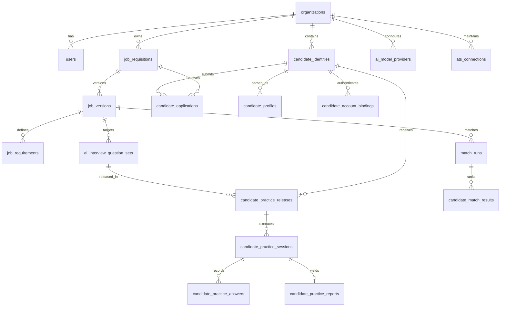

# AI-Hiring Platform: Backend Domain Services, Data Models & API Reference

**Document Version:** 2.0.0 (Phase 1 through Phase 4B.5)  
**Framework:** Python 3.14 | FastAPI 0.115+ | SQLAlchemy 2.0 (PostgreSQL 16) | Pydantic v2 | Alembic  
**Scope:** Complete Backend Directory Inventory, 19 REST Routers, 14 Relational Models, 17 Schema Modules, 63 Domain Services, 33 Alembic Migrations, and 70+ Pytest Test Suites

---

## 1. Backend Architecture & Directory Catalog

The backend follows a layered Clean Architecture pattern where HTTP transport (`api/`), domain business rules (`services/`), data persistence (`models/`), and data transfer serialization (`schemas/`) are strictly decoupled.

```
backend/
├── alembic.ini                              # Configuration file for Alembic migrations
├── pytest.ini                               # Configuration for test execution and markers
├── requirements.txt                         # Production and test Python dependencies
├── app/
│   ├── config.py                            # Environment settings and application configuration
│   ├── database.py                          # SQLAlchemy engine, session maker, base model
│   ├── main.py                              # FastAPI application instantiation and middleware
│   ├── api/                                 # 19 REST API Router Controllers
│   ├── cli/                                 # CLI Utilities & Seeders
│   ├── models/                              # 14 SQLAlchemy Declarative Model Modules
│   ├── schemas/                             # 17 Pydantic Request/Response Schema Modules
│   └── services/                            # 63 Domain Services & Algorithmic Engines
├── migrations/
│   ├── env.py                               # Alembic runtime environment loader
│   ├── script.py.mako                       # Template for new migration scripts
│   └── versions/                            # 33 Sequential Database Migration Scripts
├── runtime/                                 # Ephemeral intake and quarantine storage
├── tests/                                   # 70+ Automated Pytest Test Suites
└── tools/                                   # Admin bootstrapping and evaluation benchmark tools
```

---

## 2. Core Infrastructure & Configuration Files

### 2.1 `app/config.py`
- **Purpose**: Defines strongly-typed configuration settings loaded from environment variables or `.env` using Pydantic Settings.
- **Key Parameters**:
  - `DATABASE_URL`: PostgreSQL connection string (`postgresql+psycopg2://...`).
  - `SECRET_KEY`: HMAC encryption key for user sessions and cookies.
  - `CSRF_SECRET_KEY`: Dedicated secret for cryptographic CSRF tokens.
  - `SESSION_EXPIRE_HOURS`: Lifespan of active user and candidate sessions (default: 24h).
  - `DEFAULT_AI_PROVIDER_TYPE`, `DEFAULT_AI_PROVIDER_URL`, `DEFAULT_AI_MODEL_IDENTIFIER`: Settings for local LLM inference (MLX/Ollama).
  - `MAX_UPLOAD_SIZE_BYTES`: Upload size ceiling (default: 10 MB).
  - `QUARANTINE_DIR`, `RESUME_INTAKE_DIR`: Local filesystem paths for staging uploads.

### 2.2 `app/database.py`
- **Purpose**: Initializes SQLAlchemy database engine, scoped session factory (`sessionmaker`), and declarative Base class.
- **Key Components**:
  - `engine`: Created with connection pool tuning (`pool_pre_ping=True`, `pool_size=20`, `max_overflow=10`).
  - `SessionLocal`: Session factory yielding transactional sessions.
  - `get_db()`: FastAPI dependency generator ensuring transactions are cleanly committed or rolled back and closed.
  - `Base`: Common DeclarativeBase with UUID primary key helpers and timestamp mixins (`created_at`, `updated_at`).

### 2.3 `app/main.py`
- **Purpose**: Application root creating the FastAPI app instance, configuring middleware, and mounting all API routers.
- **Key Middleware**:
  - `CORSMiddleware`: Configured for credentials, origin filtering, and custom headers.
  - `CSRFMiddleware`: Custom middleware verifying `X-CSRF-Token` headers against signed CSRF cookies for all mutating methods.
  - Custom Exception Handlers: Standardized error responses returning `{ "detail": ..., "error_code": ... }`.
- **Router Mounting**: Registers 19 routers under `/api/v1` namespace.

### 2.4 `app/cli/seed_defaults.py` & `tools/bootstrap_admin.py`
- **Purpose**: Database seeding utilities for fresh environment bootstrap.
- **Actions**:
  - Creates default Organization (`Default Organization`).
  - Creates initial Administrator user (`admin@platform.local`).
  - Loads occupational codes from `Local_data/occupation_data.csv` and software skills from `Local_data/software_skills.csv`.

---

## 3. REST API Routers (`app/api/`)

The API layer is partitioned into 19 specialized controllers:

| Router File | Prefix / Tag | RBAC Guard | Description & Key Endpoints |
|---|---|---|---|
| `admin.py` | `/api/v1/admin` | `require_admin` | System health overview, database statistics, security audit event log querying. |
| `admin_providers.py` | `/api/v1/admin/providers` | `require_admin` | CRUD for AI Model Providers (MLX, Ollama, OpenAI-compatible), endpoint connectivity tests, active provider switching. |
| `ai_interviews.py` | `/api/v1/ai-interviews` | `require_recruiter` | AI Interview generation workspace, slot management, candidate-safe previews, recruiter rubrics. |
| `ai_question_sets.py` | `/api/v1/ai-question-sets` | `require_recruiter` | AI Question Studio, 20-point server-side validation matrix, recruiter approval, rewording assistance. |
| `ats.py` | `/api/v1/ats` | `require_recruiter` | ATS integration management (Greenhouse, Lever, Local Folder ATS), candidate export, requisition sync. |
| `auth.py` | `/api/v1/auth` | Public / Session | Recruiter/Admin authentication, login (`POST /login`), logout (`POST /logout`), session validation (`GET /me`), password change. |
| `candidate_access.py` | `/api/v1/candidates` | `require_recruiter` | Recruiter invitation management, generation of magic activation links, candidate account binding queries. |
| `candidate_auth.py` | `/api/v1/candidate/auth` | Public / Candidate | Candidate portal authentication, magic token activation (`POST /activate`), candidate login (`POST /login`), candidate session (`GET /me`). |
| `candidate_jobs.py` | `/api/v1/candidate/jobs` | Public / Candidate | Candidate public job discovery board, published requisition listings, requirement summaries. |
| `candidate_practice.py` | `/api/v1/candidate/practice` | `require_candidate` | Candidate practice interview catalog, practice session lifecycle (`/start`, `/answer`, `/report`), attempt tracking. |
| `candidates.py` | `/api/v1/candidates` | `require_recruiter` | Resumé ingestion (`POST /resumes`), parsing, candidate profiles (`GET /{id}`), evidence spans, manual profile corrections. |
| `dependencies.py` | Global | N/A | Security dependencies: `get_current_user`, `require_admin`, `require_recruiter`, `require_candidate`, `get_db`, `get_csrf_token`. |
| `gap_reports.py` | `/api/v1/gap-reports` | `require_recruiter` | Generates requirement gap reports comparing candidate skills against job requirements with categorical breakdowns. |
| `health.py` | `/api/v1/health` | Public | Liveness probe, readiness probe, and PostgreSQL connectivity check. |
| `interviews.py` | `/api/v1/interviews` | `require_recruiter` | Deterministic interview templates, structured question banks, simulation runs, and human review scores. |
| `jobs.py` | `/api/v1/jobs` | `require_recruiter` | Job requisition CRUD, immutable version creation, grounded requirements, readiness checks, publication toggles. |
| `match_runs.py` | `/api/v1/match-runs` | `require_recruiter` | Executes deterministic candidate-job matching, ranking results, component score decompositions, evidence comparison. |
| `recruiter_applications.py` | `/api/v1/recruiter/applications` | `require_recruiter` | Recruiter applicant review workflow, stage transitions (`RECEIVED` -> `IN_REVIEW` -> `INTERVIEW_READY`), interview release. |
| `taxonomy.py` | `/api/v1/taxonomy` | `require_recruiter` | Skill taxonomy search, concept resolution, occupation autocomplete, alias lookup. |

---

## 4. SQLAlchemy Relational Models (`app/models/`)

The database architecture consists of 14 model modules mapping to 20+ tables:



### Detailed Model Inventory
1. **`user.py`**:
   - `Organization`: Multi-tenant organization container (`id`, `name`, `created_at`).
   - `User`: System user (`id`, `email`, `hashed_password`, `role`: `ADMIN` | `RECRUITER` | `CANDIDATE`, `organization_id`, `status`).
   - `UserSession`: Active session tracking (`id`, `user_id`, `session_token_hash`, `expires_at`, `ip_address`).
   - `PasswordResetToken`: Single-use password reset tokens with strict expiry.
2. **`job.py`**:
   - `JobRequisition`: Master requisition container (`id`, `organization_id`, `status`: `DRAFT` | `READY` | `PUBLISHED` | `ARCHIVED`, `publication_status`: `DRAFT` | `PUBLISHED` | `ARCHIVED`).
   - `JobVersion`: Immutable version record (`id`, `job_id`, `version_number`, `revision`, `title`, `department`, `location`, `employment_type`, `workplace_type`, `summary`, `responsibilities`, `version_status`).
   - `JobRequirement`: Grounded requirement (`id`, `job_version_id`, `category`: `SKILL` | `EXPERIENCE` | `EDUCATION` | `CERTIFICATION`, `necessity`: `MUST_HAVE` | `PREFERRED`, `requirement_text`, `taxonomy_concept_id`, `weight`, `display_order`).
3. **`candidate.py`**:
   - `CandidateIdentity`: Canonical candidate entity (`id`, `organization_id`, `primary_email`, `full_name`, `created_at`).
   - `CandidateProfile`: Parsed resume snapshot (`id`, `candidate_id`, `version_number`, `raw_text`, `structured_data` (JSONB), `confidence_score`, `extraction_metadata`).
   - `CandidateEvidenceSpan`: Verifiable span offsets (`id`, `profile_id`, `section_name`, `field_name`, `start_char`, `end_char`, `bounding_box` (JSONB)).
4. **`candidate_access.py`**:
   - `CandidateInvitation`: Magic invitation record (`id`, `organization_id`, `candidate_id`, `email`, `invitation_token_hash`, `status`, `expires_at`).
   - `CandidateAccountBinding`: Links candidate identity to user login credentials (`id`, `candidate_id`, `user_id`, `is_active`).
5. **`candidate_application.py`**:
   - `CandidateApplication`: Job application record (`id`, `organization_id`, `candidate_id`, `job_id`, `job_version_id`, `status`: `DRAFT` | `RESUME_PROCESSING` | `READY_TO_SUBMIT` | `SUBMITTED` | `WITHDRAWN`, `recruiter_review_state`: `RECEIVED` | `IN_REVIEW` | `INTERVIEW_READY`, `submitted_at`, `withdrawn_at`).
6. **`candidate_practice.py`**:
   - `CandidatePracticeRelease`: Recruiter release grant (`id`, `organization_id`, `candidate_id`, `job_id`, `job_version_id`, `ai_question_set_id`, `status`: `ACTIVE` | `REVOKED` | `EXPIRED`, `max_attempts`).
   - `CandidatePracticeSession`: Individual simulation run (`id`, `release_id`, `candidate_id`, `attempt_number`, `session_state`: `NOT_STARTED` | `IN_PROGRESS` | `COMPLETED` | `ABANDONED`, `started_at`, `completed_at`).
   - `CandidatePracticeAnswer`: Per-turn candidate response (`id`, `session_id`, `slot_id`, `question_type`: `CONVERSATIONAL` | `MCQ`, `answer_text`, `selected_option_id`, `is_follow_up`, `ai_feedback` (JSONB), `score`).
   - `CandidatePracticeReport`: Comprehensive coaching scorecard (`id`, `session_id`, `overall_score`, `dimension_scores` (JSONB), `strengths` (JSONB), `priority_improvements` (JSONB), `playbook` (JSONB)).
7. **`ai_interview.py`**:
   - `AIInterviewQuestionSet`: Validated question set (`id`, `job_id`, `job_version_id`, `set_version`, `status`: `DRAFT` | `APPROVED` | `ARCHIVED`, `provider_class`, `model_identifier`, `prompt_template_version`, `guardrail_policy_version`, `items` (JSONB)).
8. **`match_run.py`**:
   - `MatchRun`: Batch match execution record (`id`, `organization_id`, `job_version_id`, `executed_by_user_id`, `total_candidates`, `created_at`).
   - `CandidateMatchResult`: Individual candidate match score (`id`, `match_run_id`, `candidate_id`, `profile_id`, `overall_score`, `component_scores` (JSONB), `rank`, `missing_skills` (JSONB)).
9. **`gap_report.py`**:
   - `RequirementGapReport`: Categorical gap report (`id`, `organization_id`, `job_version_id`, `candidate_id`, `overall_coverage_pct`, `gaps` (JSONB)).
10. **`model_provider.py`**:
    - `AIModelProvider`: Registered inference adapters (`id`, `organization_id`, `provider_name`, `provider_type`: `LOCAL_OPENAI_COMPATIBLE` | `MLX` | `OLLAMA`, `base_url`, `model_identifier`, `is_active`, `health_status`).
11. **`ats.py`**:
    - `AtsConnection`: ATS integration settings (`id`, `organization_id`, `provider`: `GREENHOUSE` | `LEVER` | `LOCAL_FOLDER`, `auth_config` (JSONB), `sync_status`).
12. **`taxonomy.py`**:
    - `SkillConcept`, `SkillAlias`, `OccupationConcept`: Standardized taxonomy graphs and alias lookup tables.
13. **`audit.py`**:
    - `SecurityAuditEvent`: Immutable audit log (`id`, `organization_id`, `user_id`, `event_type`, `resource_type`, `resource_id`, `payload` (JSONB), `ip_address`, `created_at`).
14. **`interview.py`**:
    - Legacy deterministic interview templates, simulation runs, rubrics, and evaluation reviews.

---

## 5. Pydantic Validation Schemas (`app/schemas/`)

The schema layer guarantees type safety, request payload validation, and response data filtering:

- **`ai_question_set.py`**:
  - `AIQuestionSetCreate`, `AIQuestionSetResponse`, `AIQuestionSlotItem`, `MCQOptionSchema`, `ValidationOutcomeSchema` (20-point check results), `ApprovalPayload`.
- **`candidate_application.py`**:
  - `CreateDraftApplicationPayload`, `SubmitApplicationPayload`, `CandidateApplicationResponse`, `CandidateApplicationSummaryResponse`.
- **`candidate_practice.py`**:
  - `PracticeReleaseRequest`, `PracticeReleaseResponse`, `PracticeSessionStartResponse`, `SubmitAnswerPayload`, `AnswerReviewResponse`, `PracticeCoachingReportResponse`.
- **`job.py`**:
  - `JobCreatePayload`, `JobVersionCreatePayload`, `RequirementCreatePayload`, `JobReadinessResponse`, `JobDetailResponse`, `JobSummaryResponse`.
- **`match_run.py`**:
  - `CreateMatchRunPayload`, `MatchRunResponse`, `CandidateMatchDetailResponse`, `ScoreDecompositionSchema`.
- **`candidate.py`**:
  - `CandidateProfileResponse`, `EvidenceSpanSchema`, `ProfileCorrectionPayload`, `CandidateExtractionSummary`.
- **`recruiter_application.py`**:
  - `RecruiterApplicationListResponse`, `RecruiterApplicationDetailResponse`, `UpdateReviewStatePayload`, `InterviewReleasePayload`.
- **`auth.py` & `candidate_access.py`**:
  - `LoginRequest`, `AuthResponse`, `InviteCandidatePayload`, `ActivateCandidatePayload`, `ChangePasswordPayload`.

---

## 6. Domain Services & Algorithmic Engines (`app/services/`)

The service layer contains 63 modules implementing pure business logic:

### 6.1 Parsing & Evidence Extraction Pipeline
1. `pdf_text_extraction.py` & `docx_text_extraction.py`: Low-level extractors capturing text lines, font attributes, table cells, and coordinate bounding boxes.
2. `pdf_layout_extraction.py` & `section_detection.py`: Identifies document columns, flows, and section boundaries (`WORK_EXPERIENCE`, `EDUCATION`, `SKILLS`, `PROJECTS`, `CERTIFICATIONS`).
3. `identity_extraction.py`: Regex and heuristic parser extracting candidate name, email, phone number, and location with boundary checks.
4. `employment_extraction.py` & `education_project_certification_extraction.py`: Extracts chronological employment spans, employer names, job titles, degrees, majors, GPAs, and project descriptions.
5. `skill_summary_extraction.py` & `taxonomy_normalization.py`: Normalizes extracted skill terms against the canonical taxonomy graph, resolving aliases (e.g. "ReactJS" -> `concept: react_framework`).
6. `extraction_orchestration.py` & `profile_assembly.py`: Master controller assembling raw extraction data into a unified `CandidateProfile`.
7. `extraction_persistence.py`: Stores the profile along with character-level `CandidateEvidenceSpan` records.
8. `profile_correction.py`: Applies recruiter audit patches (`REPLACE`, `DELETE`, `ADD`) to profile fields while preserving original evidence audit logs.

### 6.2 Deterministic Matching & Gap Analysis
1. `deterministic_matching.py`: Core category-weighted scoring engine.
   - Computes match strength for each grounded requirement:
     $$\text{RequirementScore}(r) = \begin{cases} 1.0 & \text{if Full Match} \\ 0.5 & \text{if Partial / Alias Match} \\ 0.0 & \text{if Missing} \end{cases}$$
   - Aggregates category scores by requirement necessity (`MUST_HAVE` weight multiplier $\times 2.0$, `PREFERRED` $\times 1.0$).
2. `gap_derivation.py` & `gap_report_service.py`: Generates missing skill gap reports categorized by Technical Skills, Experience, and Education with actionable gap summaries.
3. `explanation.py`: Produces transparent, human-readable explanations of match scores and confidence tiers (`HIGH`, `MEDIUM`, `LOW`).

### 6.3 AI Provenance & 20-Point Release Engine (`ai_provenance_service.py`)
Enforces the mandatory 20 server-side validation checks before any AI question set can be approved or released:
1. **Character Length Bounds**: Question text must be between 15 and 800 characters.
2. **HTML Tag Rejection**: Rejects any `<tag>` injections.
3. **URL & Link Rejection**: Forbids `http://`, `https://`, and `www.` URLs.
4. **Control Character Stripping**: Forbids unprintable ASCII `[\x00-\x1F]`.
5. **Markdown Header Stripping**: Forbids `#` header formatting in question stems.
6. **Tool Code Injection Prevention**: Rejects LLM tool artifacts (`<tool_call>`, ````python````).
7. **Protected Attribute Filters**: Strict keyword filter blocking race, religion, gender, age, disability, marital status, or nationality questions.
8. **Anti-Hallucination Guardrail**: Detects and forbids fabricated candidate past experience assertions (`"In your time at Microsoft..."`).
9. **Requirement Grounding Verification**: Asserts that every question is tied to a valid `requirement_id` on the target job version.
10. **MCQ Option Count**: Ensures exactly 2 to 5 distinct options.
11. **MCQ Unique Options**: Prevents duplicate option strings.
12. **MCQ Valid Correct Key**: Verifies `correct_option_id` exists in the option list.
13. **MCQ Non-Empty Explanation**: Ensures educational explanation is present.
14. **Time Bounds**: Estimated response time must be between 1 and 10 minutes.
15. **Target Job Version Integrity**: Rejects sets targeting mismatched or archived job revisions.
16. **Authoring Provenance Completeness**: Validates `authoring_origin` is `LOCAL_LLM_GENERATED` or `LOCAL_LLM_GENERATED_RECRUITER_EDITED`.
17. **Model Identifier Tracking**: Verifies registered `model_identifier` is logged.
18. **Prompt Version Tracking**: Verifies `prompt_template_version` is recorded.
19. **Policy Version Tracking**: Verifies `guardrail_policy_version` is recorded.
20. **Legacy Question Rejection**: Blocks sets containing legacy unprovenanced deterministic questions.

### 6.4 AI Question Generation & Wording Studio
1. `ai_interview_orchestrator.py` & `ai_interview_generation_service.py`: Builds structured prompts injecting grounded job requirements and calls the active local LLM adapter.
2. `ai_question_set_service.py`: Manages the lifecycle (`DRAFT` -> `APPROVED` -> `ARCHIVED`) of generated question sets.
3. `wording_assistance_service.py`, `wording_prompt_package.py`, `wording_provider.py`, `wording_validation_service.py`: Generates recruiter question wording variants with safety validation.

### 6.5 Interactive Candidate Practice & Simulation Engine
1. `candidate_practice_service.py`: Manages recruiter practice release grants, candidate catalog discovery, and diagnostic release checks.
2. `practice_session_service.py`: Implements the interactive turn-taking state machine:
   - `CONVERSATIONAL` Turn: Main question prompt -> Candidate response -> AI evaluation -> Optional 1-turn adaptive probe -> Final response -> Next slot.
   - `MCQ` Turn: Stem & options -> Candidate selection -> Server-side scoring -> Explanation reveal -> Next slot.
3. `practice_follow_up_service.py`: Analyzes candidate conversational responses and generates grounded follow-up probes if the response lacks depth or clarity.
4. `practice_review_service.py`: Real-time per-answer feedback assessing clarity, technical depth, relevance, and STAR structure.
5. `practice_report_service.py`: Compiles post-session coaching scorecards featuring multi-dimensional competency radar charts (0–100), identified strengths, priority improvements, and tailored interview playbooks.

### 6.6 ATS & External Integrations
1. `ats_integration_service.py`: Unified adapter interface for Greenhouse, Lever, and Local Folder ATS (`local_ats_demo/`). Handles bi-directional synchronization of candidates and job requisitions.

---

## 7. Database Migrations (`migrations/versions/`)

The database schema is version-controlled through 33 sequential Alembic migrations:

1. `e1a05c742301`: Initial authentication tables (`organizations`, `users`, `user_sessions`).
2. `b7c2d8e4f1a0`: Taxonomy tables (`skill_concepts`, `skill_aliases`, `occupations`).
3. `c83f120ab59e`: Candidate profile and evidence span tables (`candidate_identities`, `candidate_profiles`, `candidate_evidence_spans`).
4. `c9d3e5f7a2b1`: Job requisitions, versions, and requirement tables.
5. `d1e4f6a8b2c3`: Job description document import tables.
6. `e2f5a7b9c1d4`: `READY_FOR_MATCHING` job lifecycle state migration.
7. `f4c2e6a8d1b3`: Match runs and candidate match results tables.
8. `d92e10a8b71f`: Profile manual correction and audit tables.
9. `b3b1c0a2d4e6`: Phase 3B interview persistence tables.
10. `d4e5f6a7b8c9`: Phase 3D1 simulation tables.
11. `e5f6a7b8c9d0`: Phase 3D2 provisional assessment tables.
12. `f6a7b8c9d0e1`: Phase 3D3 human evaluation review tables.
13. `c1d2e3f4a5b6`: ATS integration connections and sync tables.
14. `d1e2f3a4b5c6`: Local folder demo ATS adapter configuration.
15. `f1a2b3c4d5e6`: Candidate invitations and account binding tables.
16. `f2a3b4c5d6e7`: MCQ authoring and practice release tables.
17. `f3a4b5c6d7e8`: Candidate practice session and answer tables.
18. `f5a6b7c8d9e0`: Candidate practice request and catalog tables.
19. `g1a2b3c4d5e6`: Phase 3G1 AI provenance and release eligibility schema.
20. `h1a2b3c4d5e6`: Phase 3G2 per-answer AI coaching review tables.
21. `i1a2b3c4d5e6`: Phase 3G3 candidate practice coaching report tables.
22. `j1a2b3c4d5e6`: Phase 3G live interview lifecycle tables.
23. `k1a2b3c4d5e6`: Practice session column length adjustments.
24. `l1a2b3c4d5e6`: Candidate job applications table (`candidate_applications`).
25. `m1a2b3c4d5e6`: Recruiter review state column (`recruiter_review_state`).
26. `n1a2b3c4d5e6`: Publication status column on job requisitions (`publication_status`).
27. `o1a2b3c4d5e6`: Security audit event enums for applications and review states.
28. `p1a2b3c4d5e6`: Candidate application lifecycle and resume artifact fields.
29. `q1a2b3c4d5e6`: Made binding invitation ID nullable for self-registration.
30. `c2f8c4604f59`: Added `is_archived` to model provider profiles.
31. `c4a1d8e2f5b7`: Updated security audit event enums for model providers.
32. `e1f2a3b4c5d6`: Added soft-delete support for job requisitions.
33. `f35cae6d57b1`: Added requirement names to gap report items.

---

## 8. Pytest Test Directory & Verification Suites (`tests/`)

The backend test suite contains 70+ test files comprising 900+ automated test cases:

```
backend/tests/
├── evaluation_support/                      # Precision/recall benchmark harness
│   ├── alignment.py                         # Aligns parsed entities with ground-truth spans
│   ├── cli.py                               # CLI runner for evaluation harness
│   ├── evaluator.py                         # Computes precision, recall, and F1 metrics
│   ├── integrity.py                         # Checks raw text preservation and offset consistency
│   ├── normalization.py                     # Normalizes entity text for fuzzy evaluation
│   └── schemas.py                           # Evaluation dataset schemas
├── fixtures/                                # Ground-truth JSON and resume files (PDF/DOCX)
│   ├── evaluation/
│   │   ├── documents/                       # Multi-page, two-column, and table-based resumes
│   │   ├── ground_truth/                    # Human-labeled ground truth JSON files
│   │   └── manifest.json                    # Evaluation dataset manifest
├── test_auth_foundation.py                  # Tests PBKDF2 hashing, session creation, CSRF token generation
├── test_auth_lifecycle.py                   # Tests recruiter login, session expiry, logout, password change
├── test_candidate_access_lifecycle.py       # Tests magic invitation tokens, expiry, candidate account bindings
├── test_candidate_practice_eligibility_and_requests.py # Tests 20-point diagnostic release checks
├── test_candidate_practice_engine.py        # Tests interactive practice turn-taking state machine
├── test_candidate_schemas.py                # Tests Pydantic validation on candidate ingestion schemas
├── test_candidate_self_registration.py      # Tests candidate portal registration and direct login
├── test_controlled_matching_e2e.py          # End-to-end test of candidate matching against benchmark jobs
├── test_corpus_integrity.py                 # Tests raw text preservation and span boundary integrity
├── test_deterministic_matching.py           # Tests category-weighted match formula and scoring accuracy
├── test_docx_text_extraction.py             # Tests Word DOCX paragraph and table parsing
├── test_docx_validation.py                  # Tests DOCX file safety, MIME types, and error handling
├── test_education_project_certification_extraction.py # Tests education and certification parsers
├── test_employment_extraction.py            # Tests employment history, employer names, and date spans
├── test_evaluation.py                       # Tests evaluation harness benchmark calculation
├── test_explanation.py                      # Tests human-readable match explanation generation
├── test_extraction_contract.py              # Tests extraction DTO contracts and serialization
├── test_extraction_orchestration.py         # Tests end-to-end resume extraction pipeline
├── test_gap_report_api.py                   # Tests gap report REST endpoints and query filters
├── test_gap_report_persistence.py           # Tests database persistence of gap reports
├── test_gap_report_phase2d5.py              # Tests categorical gap grouping and summary metrics
├── test_health.py                           # Tests health check endpoints (/health/liveness, /readiness)
├── test_identity_extraction.py              # Tests candidate name, email, and phone regex extraction
├── test_isolated_sessions.py                # Tests multi-tenant session isolation and cookie flags
├── test_job_domain.py                       # Tests job requisition CRUD and immutable versioning
├── test_job_imports.py                      # Tests importing job descriptions from raw text/PDF
├── test_job_readiness.py                    # Tests job readiness rule engine before matching
├── test_job_release.py                      # Tests job publication and release status transitions
├── test_job_requirements.py                 # Tests grounded requirement creation and taxonomy links
├── test_match_api.py                        # Tests match run API endpoints (/match-runs)
├── test_match_persistence.py                # Tests match run and result DB storage
├── test_match_ranking.py                    # Tests candidate ranking and tie-breaking algorithms
├── test_match_service.py                    # Tests match orchestration across multiple candidates
├── test_matching_contracts.py               # Tests match schema serialization contracts
├── test_matching_preflight.py               # Tests preflight checks before running matches
├── test_mcq_and_practice_release.py         # Tests MCQ validation and recruiter practice releases
├── test_parser_evaluation.py                # Runs precision/recall evaluation against fixture resumes
├── test_parser_regressions.py               # Tests known edge-case resumes to prevent regressions
├── test_pdf_layout_extraction.py            # Tests two-column and multi-page PDF layout detection
├── test_pdf_text_extraction.py              # Tests PDFPlumber text extraction and bounding boxes
├── test_pdf_validation.py                   # Tests PDF corruption detection and header checks
├── test_phase3a2_contracts.py               # Tests AI provider DTO contracts
├── test_phase3a3_provider_config.py         # Tests model provider configuration loading
├── test_phase3a4_provider_admin.py          # Tests provider admin API endpoints
├── test_phase3a5_verification.py            # Tests AI provider connectivity test suite
├── test_phase3b1_persistence_and_snapshots.py # Tests question set snapshot immutability
├── test_phase3b2_deterministic_generator.py # Tests rule-based question bank generator
├── test_phase3b3_candidate_plans.py         # Tests candidate interview plan compilation
├── test_phase3b4_lifecycle_and_approval.py  # Tests question set approval lifecycle
├── test_phase3b5_closure_verification.py    # Tests end-to-end question studio workflow
├── test_phase3c1_provider_foundation.py     # Tests wording provider foundation
├── test_phase3c2_wording_contract.py        # Tests question rewording DTO schemas
├── test_phase3c3_semantic_validation.py     # Tests question safety and injection validation
├── test_phase3c4_recruiter_ui_integration.py # Tests rewording assistance API integration
├── test_phase3c_response_classification_and_selection.py # Tests question selection heuristics
├── test_phase3d1_simulation_and_repairs.py  # Tests pre-release interview simulation engine
├── test_phase3d2_provisional_assessment.py  # Tests provisional scoring during simulations
├── test_phase3d3_human_review.py            # Tests human reviewer scoring and calibration
├── test_phase3d4_evaluation.py              # Tests interview simulation evaluation metrics
├── test_phase3d5_ai_workspace.py            # Tests AI interview workspace endpoints
├── test_phase3e3_ats.py                     # Tests Greenhouse and Lever ATS integration adapters
├── test_phase3e3_local_folder_ats.py        # Tests Local Folder ATS file inbox/outbox syncing
├── test_phase3g1_provenance_and_release_eligibility.py # Tests 20 server-side validation checks
├── test_phase3g2_per_answer_coaching.py     # Tests real-time per-answer AI review engine
├── test_phase3g3_coaching_report.py         # Tests multi-dimensional radar report generation
├── test_phase3g_live_interview.py           # Tests live interview turn-taking execution
├── test_phase4a2_job_grounded_generation.py # Tests requirement-grounded LLM question prompts
├── test_phase4a3_answer_assessment.py       # Tests answer assessment scoring rubric accuracy
├── test_phase4a4_workflow_authorization.py  # Tests recruiter authorization for AI actions
├── test_phase4b2_candidate_authz_kernel.py  # Tests candidate authorization kernel and token guards
├── test_phase4b3_candidate_job_discovery.py # Tests candidate job discovery and detail views
├── test_phase4b4_candidate_applications.py  # Tests candidate application drafts and submissions
├── test_phase4b5_recruiter_applicant_workflow.py # Tests recruiter applicant review stage transitions
├── test_processing_lifecycle.py             # Tests resume intake and quarantine lifecycle
├── test_profile_assembly.py                 # Tests CandidateProfile object construction
├── test_profile_correction.py               # Tests recruiter manual correction patch operations
├── test_requirement_gap_contracts.py        # Tests gap report DTO contracts
├── test_requirement_gap_derivation.py       # Tests algorithm deriving missing requirement gaps
├── test_resume_models.py                    # Tests CandidateIdentity and Profile model methods
├── test_resume_upload.py                    # Tests resume upload multipart endpoint
├── test_role_enforcement.py                 # Tests RBAC role enforcement (Admin vs Recruiter vs Candidate)
├── test_scoring.py                          # Tests mathematical scoring equations
├── test_section_detection.py                # Tests regex section detection heuristics
├── test_skill_summary_extraction.py         # Tests skill summary and years of experience calculator
├── test_taxonomy_domain.py                  # Tests taxonomy concept lookup and alias resolution
└── test_text_normalization.py               # Tests unicode cleaning and text normalization
```
