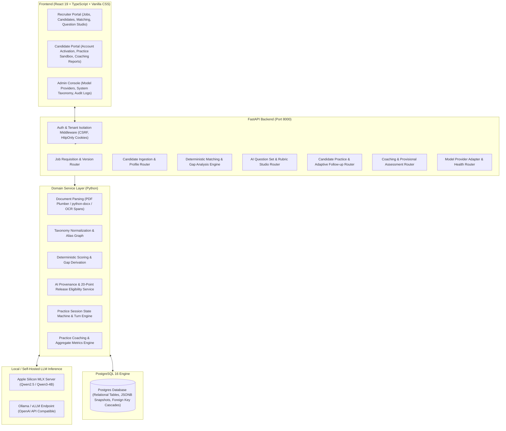
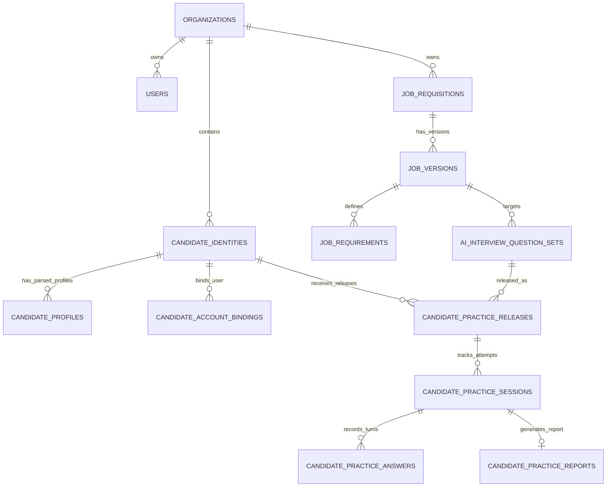

# AI-Hiring Platform: System Architecture & Technical Blueprint
**Document Version:** 1.0.0 (Phase 1 through Phase 3G.3)  
**System Classification:** Enterprise AI-Assisted Candidate Sourcing, Deterministic Matching & Interactive Practice Interview Platform  
**Target Environment:** Python 3.14 (FastAPI + SQLAlchemy Async/Sync + PostgreSQL 16) | React 19 + TypeScript (Vite + Vanilla CSS Design System) | Local MLX/Ollama/OpenAI-compatible Inference

---

## 1. System Overview & Core Philosophy

The **AI-Hiring Platform** is an enterprise-grade recruiting, candidate evaluation, deterministic skill-matching, and AI-powered practice interview simulation system. It eliminates arbitrary LLM scoring by establishing a rigorous **two-tier architecture**:

1. **Deterministic, Auditable Business Logic**:
   - Resumé parsing with exact bounding-box evidence spans and character offsets.
   - Skill extraction tied to curated, multi-version taxonomy graphs.
   - Rule-based, explainable scoring criteria with transparent score breakdowns (no black-box scoring).
   - Strict organization tenancy, RBAC (Admin, Recruiter, Candidate), and cryptographic session isolation.

2. **Grounded, Governed AI Assistance**:
   - Dynamic interview question generation (conversational and single-answer MCQ) grounded strictly in verified job requisition requirements.
   - 20 server-side safety, quality, and anti-hallucination validation checks before any question is exposed.
   - Rigorous AI provenance tracking (`model_identifier`, `provider_class`, `prompt_template_version`, `guardrail_policy_version`).
   - Candidate practice interview sandbox with adaptive follow-ups, real-time response review, and multi-dimensional coaching reports without leaking internal calibration rubrics.



---

## 2. Global Architecture & Tenancy Model

### 2.1 Multi-Tenant Organization Isolation
- **Tenant Scope:** Every requisition, candidate identity, user account, match run, and interview set is strictly owned by an `organization_id` (UUID).
- **Enforcement:** Enforced at the SQLAlchemy ORM layer, FastAPI dependency injection filters (`require_recruiter`, `require_admin`, `require_candidate`), and cross-organization boundary validators in every service method.
- **Cross-Org Shielding:** Candidates registered under Organization A cannot have practice sets released by recruiters from Organization B under any condition (`FORBIDDEN_ORGANIZATION` 403 error).

### 2.2 Security, Authentication & Session Life Cycle
- **Transport Security:** HttpOnly, SameSite=Lax/Strict session cookies with separate cryptographic HMAC CSRF double-submit token verification on all mutations (`POST`, `PUT`, `PATCH`, `DELETE`).
- **User Roles:**
  - `ADMIN`: Full tenant system management, local LLM provider configuration, connection tests, system taxonomy uploads.
  - `RECRUITER`: Job requisition authoring, candidate resume ingestion, profile manual corrections, match scoring execution, AI question set generation/editing/approval, candidate practice releasing.
  - `CANDIDATE`: Magic-token portal activation, practice interview catalog viewing, interactive conversational and MCQ simulation, personalized report consumption.
- **Password Policies & Crypto:** PBKDF2-SHA256 password hashing with salt, rate-limited login endpoints, and single-use activation invitation tokens with strict expiry windows.

---

## 3. Database Schema & Data Models

The relational database schema is structured into 6 primary cohesive domains:



### 3.1 Core Table Structures
1. **`users` & `user_sessions`**:
   - `user_id` (UUID, PK), `email`, `hashed_password`, `role` (`ADMIN`, `RECRUITER`, `CANDIDATE`), `organization_id`, `status` (`ACTIVE`, `SUSPENDED`).
2. **`job_requisitions`, `job_versions`, `job_requirements`**:
   - Immutable versioning model. Edits create new `JobVersion` revisions with incremented `version_number`.
   - `JobRequirement`: `category` (`TECHNICAL_SKILL`, `DOMAIN_KNOWLEDGE`, `EDUCATION`, `EXPERIENCE`, `CERTIFICATION`), `requirement_text`, `taxonomy_concept_id`, `is_mandatory`, `weight`.
3. **`candidate_identities`, `candidate_profiles`, `candidate_evidence_spans`**:
   - Candidate resume parsing tables storing raw text, document metadata, contact information, structured experience/education/certifications, and precise character span offsets for audit proof.
4. **`ai_interview_question_sets` & `interview_rubrics`**:
   - `ai_set_id` (UUID, PK), `job_id`, `job_version_id`, `set_version`, `lifecycle_status` (`DRAFT`, `APPROVED`, `ARCHIVED`), `source_mode` (`REQUIREMENT_GROUNDED`, `BLUEPRINT_GROUNDED`), `provider_class`, `model_identifier`, `prompt_template_version`, `guardrail_policy_version`, `items` (JSONB array containing slot items, question format, rubric, permitted probes, validation state).
5. **`candidate_practice_releases` & `candidate_practice_requests`**:
   - Tracks recruiter-authorized practice releases to candidate accounts, tracking question set snapshots, job revisions, and candidate request lifecycle (`REQUESTED`, `RELEASED`, `DECLINED`).
6. **`candidate_practice_sessions`, `candidate_practice_answers`, `candidate_practice_reports`**:
   - Interactive practice attempts (`IN_PROGRESS`, `COMPLETED`, `ABANDONED`), conversational and MCQ answer submissions, real-time AI follow-up turns, and comprehensive multi-dimensional scoring and coaching reports.

---

## 4. Subsystem Deep Dives

### 4.1 Resumé Ingestion & Deterministic Parsing
- **PDF & DOCX Extraction**: Dual-engine extractor using `pdfplumber` / PyPDF and `python-docx` extracting typography, section boundaries (Experience, Education, Skills, Projects, Certifications), date ranges, and layout spans.
- **Evidence Spans**: Every parsed entity (e.g. 5 years Python at Company X) records `{ "start_offset": 1420, "end_offset": 1490, "section": "WORK_EXPERIENCE" }` ensuring 100% human-verifiable provenance without synthetic hallucinations.
- **Profile Correction System**: Granular patch operations (`REPLACE`, `DELETE`, `ADD`) allowing recruiters to audit and adjust parsed profiles while maintaining audit histories.

### 4.2 Deterministic Matching & Gap Analysis Engine
- **Taxonomy Alignment**: Direct mapping to hierarchical skill concepts with alias resolution (e.g. "ReactJS", "React.js", "React Native" -> `concept_id: react_framework`).
- **Scoring Equation**:
  $$\text{Score} = \sum_{c \in \text{Categories}} w_c \cdot \left( \frac{\sum_{r \in R_c} \text{MatchStrength}(r)}{\text{Count}(R_c)} \right)$$
- **Zero Black-Box Math**: Matches compute clear categorical statuses: `MET`, `PARTIALLY_MET`, `MISSING`, `UNKNOWN` with actionable missing skill gap explanations.

### 4.3 AI Question Studio & Provenance Enforcement (Phase 3G)
- **Zero-Leakage Architecture**: Internal calibration rubrics, rating anchors (1/3/5 scales), probe boundaries, and observable indicators are segregated from candidate-visible payloads.
- **20 Server-Side Validation Checks**:
  1. Length bounds (15 - 800 chars).
  2. Control character, URL, Markdown header, HTML tag, tool code injection prevention.
  3. Strict prohibited protected class topic guardrails (race, religion, gender, age, marital status, health).
  4. Invented candidate assertion detection (forbidding synthetic resume hallucinations).
  5. Grounding requirement verification (ensuring direct requirement linkage).
  6. MCQ option bounds (2 to 5 options), unique option text, valid single correct key, and non-empty explanations.
- **Authoritative Release Eligibility**: Releases are blocked (HTTP 422) unless question set status is `APPROVED`, exact job version matches, no legacy deterministic/manual questions are present, validation status is `PASSED`, and model/provider provenance is intact.

### 4.4 Interactive Candidate Practice & Live Simulation Engine
- **Turn-Taking State Machine**:
  - `CONVERSATIONAL` Phase: Main question display -> Candidate audio/text answer -> Adaptive follow-up question (max 1 follow-up turn per slot) -> Follow-up answer -> Next slot.
  - `MCQ` Phase: Question stem & options -> Candidate selection -> Server-side immediate scoring -> Explanation reveal.
- **Per-Answer AI Coaching Feedback**: Real-time evaluation evaluating clarity, technical depth, relevance, structure, and providing actionable immediate tips for improvement.
- **Practice Report Generation**: Multi-dimensional radar charts, competency aggregate scores, strengths/weaknesses breakdown, and interview coaching takeaways.

---

## 5. Technology Stack & Infrastructure

| Layer | Component | Technology / Version | Rationale |
|---|---|---|---|
| **Backend Runtime** | API Server | Python 3.14 + FastAPI 0.115+ | High-performance async ASGI with Pydantic v2 strict models |
| **ORM & DB** | Database Engine | PostgreSQL 16 + SQLAlchemy 2.0 | Transactional integrity, JSONB query capabilities, Alembic migrations |
| **Frontend UI** | Client App | React 19 + TypeScript 5.5+ + Vite | Pure Vanilla CSS Design System, strict types, zero bundle bloat |
| **Inference Engine** | Local AI Provider | MLX / Ollama / OpenAI API Compat | Local privacy-first LLM inference (zero data egress for sensitive resumes) |
| **Testing** | Automated Quality | Pytest + Vitest + Playwright | Over 900 automated unit, integration, and E2E regression tests |
| **Containerization**| Local & Cloud | Docker Compose + PostgreSQL | Instant reproducibility across macOS, Linux, and Cloud VMs |

---

## 6. Directory Structure & File Map

```
AI-Hiring/
├── compose.yaml                         # PostgreSQL & Service Compose Setup
├── backend/
│   ├── app/
│   │   ├── api/                         # FastAPI Routers (Auth, Jobs, Candidates, Practice, AI)
│   │   │   ├── candidate_practice.py    # Recruiter & Candidate Practice Release Endpoints
│   │   │   ├── candidate_auth.py        # Candidate Portal Activation & Session Management
│   │   │   ├── ai_question_sets.py      # AI Question Studio & Approval Endpoints
│   │   │   ├── jobs.py                  # Job Requisition & Versioning CRUD
│   │   │   └── interviews.py            # Matching, Templates, and Assessments
│   │   ├── models/                      # SQLAlchemy Relational Models (15+ Tables)
│   │   │   ├── candidate.py, candidate_access.py, candidate_practice.py
│   │   │   ├── interview.py, job.py, taxonomy.py, user.py
│   │   ├── schemas/                     # Strict Pydantic DTOs & Validation Contracts
│   │   ├── services/                    # Domain Logic & Business Rules (63+ Services)
│   │   │   ├── ai_provenance_service.py # Provenance Tracking & 20-Point Release Verification
│   │   │   ├── candidate_practice_service.py # Practice Release & Diagnostic Logic
│   │   │   ├── practice_session_service.py   # Practice Sandbox Turn State Machine
│   │   │   ├── practice_report_service.py    # Coaching Report Generation
│   │   │   ├── deterministic_matching.py     # Rule-Based Candidate-Job Matcher
│   │   │   └── pdf_text_extraction.py       # PDF Plumber Spans & Extraction
│   │   └── main.py                      # FastAPI Application Lifecycle & Middleware Assembly
│   ├── migrations/                      # Alembic Versioned DB Migration Scripts
│   └── tests/                           # 900+ Comprehensive Pytest Test Suites
└── frontend/
    └── src/
        ├── api/                         # Frontend API Fetch Clients & Type-Safe Wrappers
        ├── components/
        │   ├── candidate/               # Candidate Practice Sandbox, Modal, Reports
        │   ├── ai_studio/               # AI Question Studio, Rubrics, Validations
        │   ├── jobs/                    # Requisition Editor, Requirements Builder
        │   ├── matching/                # Match Results, Gap Breakdown Radar
        │   └── auth/                    # Login, Invite Activation, Organization Select
        └── index.css                    # Master Vanilla CSS Modern Glassmorphic Design System
```
