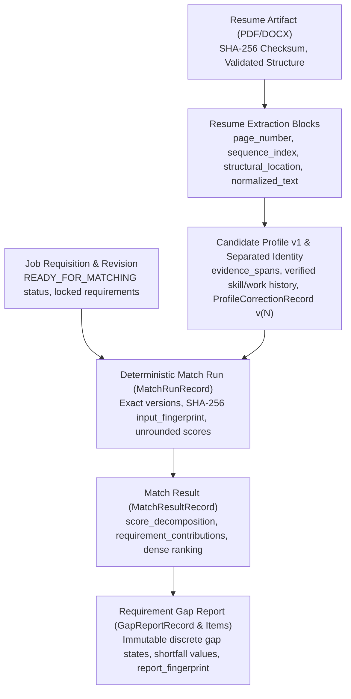

# Phase 3A.1 — Live Repository Entry Audit and Integration-Seam Mapping Record

- **Audit Date**: 2026-09-13
- **Branch**: `main`
- **Commit**: `c96a6496d42406aa0cbbf91ce8ebbc9efdad05f5`
- **Audit Phase**: Phase 3A.1 (Milestone 3 Entry Audit & Baseline Verification)

---

## 1. Executive Summary & Worktree Status

Phase 3A.1 executes a comprehensive, read-only architectural and operational audit of the live AI-Driven Smart Hiring Platform codebase before beginning any Milestone 3 interview generation, candidate simulation, model gateway, or ATS integration implementations.

### Worktree Status
- **Active Branch**: `main`
- **HEAD Commit**: `c96a6496d42406aa0cbbf91ce8ebbc9efdad05f5`
- **Git Status**: Clean (`git status --short` reported no modified or untracked working files prior to documentation creation).
- **Production Code Changes in 3A.1**: Zero modifications to production source code, backend models, migrations, frontend UI, or dependency specifications.

---

## 2. Clean Baseline Verification

The complete existing test baseline and frontend production build were executed in a single clean pass.

| Test Suite | Command | Result | Duration | Notes |
|---|---|---|---|---|
| **Backend Test Suite** | `/Users/herilvyas/Desktop/AI-Hiring/backend/.venv/bin/pytest` | **620 passed**, 2 skipped, 23 warnings | 10.37s | Full pass across all 47 test modules. Skipped: 2 optional layout visualizer tests. |
| **Frontend Test Suite** | `npm run test` (Vitest) | **78 passed** (14 test files) | 2.39s | 100% test pass rate across all auth, workspace, drawer, and gap report suites. |
| **Frontend Typecheck & Build** | `npm run build` (`tsc --noEmit && vite build`) | **Success** (Exit Code 0) | 352ms | 55 modules transformed, zero TypeScript errors. |

**Baseline Integrity Status**: **HEALTHY & PASSING**.

---

## 3. Repository Architecture & Layout Map

```
AI-Hiring/
├── compose.yaml                         # PostgreSQL 16 Alpine container service definition
├── .env.example                         # Environment configuration template
├── Local_data/                          # O*NET 28.0 offline CSV datasets (software skills, occupations, titles)
├── docs/                                # Milestone documentation
│   └── milestone-3/                     # Milestone 3 audit and planning records
├── backend/                             # Python / FastAPI application root
│   ├── alembic.ini                      # Alembic database migration configuration
│   ├── pytest.ini                       # Pytest test discovery configuration
│   ├── requirements.txt                 # Backend dependency declarations
│   ├── runtime/                         # Local storage root (quarantine & resume intake dirs)
│   ├── tools/                           # Admin bootstrap and evaluation runner scripts
│   ├── migrations/                      # Alembic migrations (13 versions, head: f35cae6d57b1)
│   ├── app/
│   │   ├── main.py                      # FastAPI app entry point & health check route
│   │   ├── config.py                    # Pydantic Settings configuration & env loading
│   │   ├── database.py                  # SQLAlchemy engine, sessionmaker, and DB connection check
│   │   ├── models/                      # SQLAlchemy declarative ORM models
│   │   │   ├── base.py                  # Base declarative class
│   │   │   ├── auth.py                  # UserRecord, UserSessionRecord, SecurityAuditEventRecord
│   │   │   ├── resume.py                # ResumeArtifact, ProcessingJob
│   │   │   ├── extraction.py            # ResumeExtraction, ResumeExtractionBlock
│   │   │   ├── candidate.py             # CandidateIdentityRecord, CandidateProfileRecord, ProfileCorrectionRecord
│   │   │   ├── job.py                   # JobRequisition, JobVersion, JobRequirement
│   │   │   ├── taxonomy.py              # TaxonomySnapshot, OccupationConcept, SkillConcept, Aliases
│   │   │   ├── matching.py              # MatchRunRecord, MatchResultRecord, MatchAuditEventRecord
│   │   │   └── gap_report.py            # GapReportRecord, GapReportItemRecord, GapAuditEventRecord
│   │   ├── schemas/                     # Pydantic validation schemas & DTOs
│   │   ├── api/                         # FastAPI route definitions (prefix: /api/v1)
│   │   │   ├── auth.py                  # /api/v1/auth (login, logout, me, change-password)
│   │   │   ├── admin.py                 # /api/v1/admin (users, audit logs, bootstrap)
│   │   │   ├── jobs.py                  # /api/v1/jobs (requisitions, drafts, requirements, readiness)
│   │   │   ├── job_imports.py           # /api/v1/jobs/imports (410 GONE deprecated endpoints)
│   │   │   ├── taxonomy.py              # /api/v1/taxonomy (occupations, skills search)
│   │   │   ├── resumes.py               # /api/v1/resumes (upload, process, profile, corrections)
│   │   │   ├── matches.py               # /api/v1/matches (runs, ranked results, explanations)
│   │   │   └── gap_reports.py           # /api/v1/gap-reports (deterministic gap derivation & json)
│   │   ├── services/                    # Pure domain and application orchestration services
│   │   └── cli/                         # Command-line tools (import_onet, bootstrap_admin, matching_eval)
│   └── tests/                           # Pytest test suite (622 test cases)
└── frontend/                            # React 19 + TypeScript + Vite SPA
    ├── package.json                     # Frontend dependencies and scripts
    ├── tsconfig.json                    # Strict TypeScript configuration
    ├── vite.config.ts                   # Vite build configuration with /api proxy to backend:8000
    ├── src/
    │   ├── main.tsx                     # React DOM entry point
    │   ├── App.tsx                      # Root component, router & top-level view orchestration
    │   ├── index.css                    # Design system (tokens, accessible non-red palette, responsive UI)
    │   ├── setupTests.ts                # Vitest & Jest-DOM test setup
    │   ├── context/AuthContext.tsx       # Auth state, session restore, CSRF injection, logout handler
    │   ├── api/                         # Centralized fetch API client with credentials and CSRF
    │   ├── utils/navigation.ts          # Safe internal return-URL validation
    │   ├── components/                  # Domain UI components, modals, and slide-out drawers
    │   │   ├── auth/                    # LoginPage, ChangePasswordPage
    │   │   ├── admin/                   # AdminWorkspace (user management, audit logs)
    │   │   ├── jobs/                    # JobEditor, CandidateComparisonView, RequirementGapReportView
    │   │   └── ...                      # ReviewerWorkspace, CandidateProfileReview, EvidenceDrawer
    │   └── __tests__/                   # Frontend Vitest test suites (14 files)
```

---

## 4. Installed and Locked Dependencies

### Backend Dependencies (Python 3.14.6 Virtualenv)
- **FastAPI**: `0.141.1`
- **Uvicorn**: `0.52.4` (standard extras with uvloop `0.22.1`, httptools `0.8.0`, watchfiles `1.2.0`)
- **Pydantic**: `2.13.4` / **Pydantic Core**: `2.46.4` / **Pydantic Settings**: `2.15.0`
- **SQLAlchemy**: `2.0.52`
- **Alembic**: `1.19.1`
- **PostgreSQL Driver**: `psycopg` `3.3.4` / `psycopg-binary` `3.3.4`
- **HTTP Client**: `httpx` `0.28.1`
- **Testing**: `pytest` `9.1.1`, `anyio` `4.14.2`, `pluggy` `1.6.0`
- **Document Extractors**: `pypdf` `6.16.2`, `pdfplumber` `0.11.10`, `pdfminer.six` `20260107`, `python-docx` `1.2.0`, `defusedxml` `0.7.1`
- **Security & Crypto**: Standard library `hashlib.scrypt`, `secrets`, `hmac` + `cryptography` `50.0.1`

### Frontend Dependencies (Node.js v24.18.1 / npm 11.16.0)
- **React**: `19.2.8`
- **React DOM**: `19.2.8`
- **TypeScript**: `7.0.2`
- **Vite**: `6.4.3` (with `@vitejs/plugin-react` `4.3.4`)
- **Vitest**: `4.1.11`
- **Testing Library**: `@testing-library/react` `16.3.3`, `@testing-library/jest-dom` `7.0.1`, `@testing-library/user-event` `14.6.6`
- **DOM Environment**: `jsdom` `30.0.1`

---

## 5. Authentication, Authorization & Security Audit

### Authentication Mechanism
- **Transport**: Secure, HttpOnly cookie containing a URL-safe 256-bit random session token (`session_cookie_name = "ai_hiring_session"`).
- **Session Persistence**: Database-backed in `user_sessions` table storing standard SHA-256 digests (`token_hash` and `csrf_token_hash`). Raw token values are never persisted.
- **Session Lifetimes**:
  - Idle timeout: 1800s (30 minutes), sliding window throttled to 60s DB updates.
  - Absolute timeout: 43200s (12 hours) hard boundary.
- **CSRF & Origin Enforcement**:
  - `verify_csrf_and_origin` dependency enforces strict `Origin` header validation against `frontend_origin` (`http://localhost:5173`) and constant-time HMAC comparison of `X-CSRF-Token` against stored hash.
- **Password Hashing**:
  - Python standard library `hashlib.scrypt` with `n=16384, r=8, p=1, dklen=32` and cryptographically secure random 16-byte salt from `os.urandom`.
  - Constant-time dummy hashing mitigation (`dummy_verify_password`) on unknown accounts to eliminate timing-based user enumeration.
  - Account lockout cooldown: 5 failed login attempts trigger a 900s (15 min) lockout.

### Role-Based Access Control (RBAC) & Object Ownership
- **Roles Defined**: `ADMIN`, `RECRUITER`, `REVIEWER`.
- **Active Operational Roles**: `ADMIN` and `RECRUITER` are fully operational. `REVIEWER` shell exists with placeholder workspace. Candidate-facing workflows are deferred.
- **Object-Level Access Boundaries**:
  - **Job Requisitions & Versions**: Enforced in `app/api/jobs.py`. Recruiters can only access and edit jobs where `created_by_user_id == actor.user_id`. Non-matching IDs return `404 NOT_FOUND` (concealment). Admins can inspect all jobs.
  - **Match Runs & Ranked Results**: Enforced in `app/services/match_orchestration.py` and `app/api/matches.py`. Recruiters can only run matches or retrieve results for jobs they own.
  - **Requirement Gap Reports**: Enforced in `app/services/gap_report_service.py` and `app/api/gap_reports.py`. Recruiters can only access gap reports linked to match results on jobs they own.
  - **Candidate Resumes & Extractions**: Enforced with `require_recruiter` dependency. In the local-development phase, all recruiters share the candidate talent pool; tenant isolation models are prepared for future multi-tenant expansion.

---

## 6. Immutable Evidence Chain & Versioning Audit

The live codebase enforces a strictly deterministic, evidence-addressable pipeline:



### Traceability Findings
1. **MatchResult Record Immutability**:
   - `MatchResultRecord` stores `job_version_id`, `profile_id`, `profile_version`, `raw_compatibility_score`, `display_compatibility_score`, `confidence_tier`, `must_have_warning_count`, and complete `score_decomposition` JSONB containing requirement-level evidence references.
   - `MatchRunRecord` stores exact `matcher_algorithm_version` (`1.0.0`), `matching_rule_version` (`phase2c2_rules_v1`), `scoring_policy_version` (`phase2c3_scoring_v1`), and input fingerprints.
2. **GapReport Record Immutability**:
   - Stores `gap_schema_version` (`1.1.0`), `gap_policy_version` (`phase2d5_gap_v1`), `wording_template_version` (`phase2d5_wording_v1`), exact `source_fingerprint`, and `report_fingerprint`.
   - ORM listeners (`@event.listens_for(..., 'before_update')`) raise `ValueError` on any attempt to mutate persisted gap reports or items.
3. **Safe Reference Contract for Interview Generation (Phase 3)**:
   - Future `InterviewBlueprintBuilder` can safely reference `report_id`, `requirement_id`, `gap_state`, `measurable_shortfall_value`, and `recruiter_wording` directly from the immutable evidence chain **without copying or storing raw PII / unprotected candidate profile payloads**.

---

## 7. Frontend Conventions & Accessibility

- **Routing & State**: Pure React state routing with browser `history.pushState` integration and bidirectional URL parameter syncing (`?view=compare_candidates&jobId=...&runId=...`, `?view=gap_report&reportId=...`).
- **Safe Navigation Utility**: `validateInternalReturnUrl` strictly filters protocol relative URLs, external domains, `javascript:` URIs, and dangerous redirects.
- **Design System & Color Policy**:
  - Strict **zero-red rule** in `frontend/src/index.css`. Semantic warnings and destructive actions use accessible dark amber/gold (`#92400e`, `#b45309`) on subtle warm backgrounds (`#fffbeb`).
  - Tested and enforced by `frontend/src/__tests__/color_policy.test.ts`.
- **Accessibility & Focus Management**:
  - ARIA attributes (`aria-live`, `role="status"`, `aria-label`, `aria-expanded`) used on drawers, search inputs, and status badges.
  - Slide-out drawers (`EvidenceDrawer`, `ReviewDrawer`, `VersionHistoryDrawer`) manage backdrop click-outside and keyboard escape dismiss.

---

## 8. Runtime & Network Boundaries

- **Docker Container**: Only PostgreSQL 16 Alpine runs inside Docker (`postgres:16-alpine` on port `5432`).
- **Host Processes**:
  - FastAPI backend runs directly on host at `http://localhost:8000`.
  - Vite dev server runs directly on host at `http://localhost:5173`.
  - In Vite development mode, requests to `/api/*` are reverse-proxied to `http://localhost:8000`.
- **Localhost Boundary for Future Local Model (Phase 3)**:
  - Because backend runs on the host, any future local llama.cpp / GGUF runner (e.g., on `http://127.0.0.1:8080`) is reached directly via standard host loopback networking.
- **Outbound HTTP Client**:
  - `httpx` is present in dependencies (`httpx 0.28.1`).
  - No active external outbound calls exist currently; all domain operations are 100% offline and deterministic.

---

## 9. Future Milestone 3 Architecture Seams

Without modifying existing codebase files, the exact module locations, dependency directions, and architectural boundaries for Milestone 3 are mapped as follows:

| Seam / Component | Proposed Module Location | Layer / Package | Allowed Dependencies | Prohibited Dependencies | Pattern Followed |
|---|---|---|---|---|---|
| **InterviewBlueprintBuilder** | `backend/app/services/interview_blueprint.py` | Domain / Application Service | `app.models.gap_report`, `app.models.job`, `app.schemas.interview` | Vendor SDKs, Model Gateway, Raw PII | `gap_derivation.py`, `explanation.py` |
| **InterviewPolicyValidator** | `backend/app/services/interview_policy.py` | Domain Policy | `app.schemas.interview`, Standard Library | Model SDKs, Network, ORM DB session | `gap_validation.py`, `matching_preflight.py` |
| **DeterministicWordingProvider** | `backend/app/services/deterministic_wording.py` | Domain Provider | `app.schemas.interview`, Standard Library | LLM APIs, external networks | `canonical_summary.py`, `explanation.py` |
| **QuestionWordingProvider (Interface)**| `backend/app/services/question_provider.py` | Domain Abstraction | `abc.ABC`, `app.schemas.interview` | Provider-specific SDKs | `app/services/` abstract protocol |
| **ModelGateway** | `backend/app/services/model_gateway/gateway.py` | Infrastructure Gateway | `httpx`, `app.config.Settings`, `pydantic` | Database ORM models, FastAPI route handlers | Pure async gateway with strict timeout |
| **ModelOutputValidator** | `backend/app/services/model_gateway/validator.py` | Infrastructure / Safety | `pydantic`, `re`, `json` | Vendor SDKs, DB | Strict JSON schema & safety bounds |
| **AssessmentAssistant** | `backend/app/services/assessment_assistant.py` | Application Orchestration | `app.services.interview_blueprint`, `app.services.model_gateway` | Vendor SDKs, direct SQL queries | `match_orchestration.py`, `gap_report_service.py` |
| **ATSAdapter (Interface)** | `backend/app/services/ats/adapter.py` | Infrastructure Adapter | `abc.ABC`, `app.schemas.ats` | Vendor-specific SDKs | Abstract adapter protocol |
| **SecretResolver** | `backend/app/services/secrets.py` | Security Infrastructure | `app.config.Settings`, `os`, `hashlib` | Logging plaintext, Frontend exports | `app/services/security.py` |
| **DestinationPolicy** | `backend/app/services/destination_policy.py` | Security / Network Policy | `urllib.parse`, `ipaddress`, `app.config` | Wildcard allowances, Unvetted domains | Strict SSRF & whitelist policy |

---

## 10. Audit Findings Matrix

| Finding | Classification | Evidence / Current State | Action / Guidance for Phase 3A.2+ |
|---|---|---|---|
| **Deterministic Parsing & Extraction** | **CONFIRMED** | Direct text extraction with regex and heuristic boundary normalization (`app/services/*_extraction.py`). No OCR or synthetic data. | Preserve spaCy/regex deterministic intake; no LLM extraction. |
| **Deterministic Matching & Scoring** | **CONFIRMED** | Pure Python mathematical scoring and discrete state evaluation (`app/services/scoring.py`, `app/services/deterministic_matching.py`). | Keep LLM completely out of matching, ranking, and scoring. |
| **Offline O\*NET Grounding** | **CONFIRMED** | O\*NET 28.0 SQLite/PostgreSQL taxonomy tables loaded offline from `Local_data/*.csv`. | Maintain offline taxonomy snapshot linkage. |
| **Recruiter Decision Ownership** | **CONFIRMED** | All consequential hiring decisions owned by recruiter; UI and reports display decision support with zero automated rejection. | Preserve decision-support framing across all Milestone 3 features. |
| **Zero-Red UI & Accessible Tokens** | **CONFIRMED** | Non-red accessible styling (`#92400e` amber warnings) verified by automated Vitest color policy suite. | Maintain design tokens in all future interview workspace UIs. |
| **Immutable Evidence Chain** | **CONFIRMED** | ORM immutability listeners and SHA-256 fingerprints on match results and gap reports. | Reference gap reports and requirement IDs without storing duplicate PII. |
| **Auth & Session Security** | **CONFIRMED** | Scrypt constant-time verification, HttpOnly cookies, SHA-256 token hashing, CSRF header checks, audit logging. | Future provider configuration endpoints must require `require_admin` + CSRF. |
| **spaCy Dependency Status** | **CHANGED SINCE HANDOFF** | Earlier architecture documents planned spaCy; live codebase successfully executes deterministic parser via regex, token normalization, and rule engine (`requirements.txt` does not include `spacy`). | Continue using deterministic regex/token normalization without adding heavy unneeded dependencies unless specifically needed. |
| **Job Import Document Parsing** | **CHANGED SINCE HANDOFF** | `/api/v1/jobs/imports/*` endpoints deprecated and return `410 GONE` in favor of manual structured job creation. | Milestone 3 blueprints build on structured `JobVersion` requirements. |
| **Candidate Role Workflow** | **CONFIRMED** | Candidate-facing workflow remains deferred as designed; `ADMIN` and `RECRUITER` are active roles. | Do not build candidate portal in Milestone 3 unless authorized. |
| **Future Model Provider / ATS Network Access** | **CONFIRMED** | No live model provider requests or ATS network calls exist in Phase 3A. | Build narrow provider-neutral gateway abstractions in Phase 3B. |

---

## 11. Security-Significant Blockers

**No security-significant blockers were identified.**
- All sensitive recruiter endpoints enforce server-side authentication, CSRF validation, and object ownership verification.
- Passwords and session tokens use industry-standard hashing (`scrypt` and `SHA-256`) with constant-time comparison.
- The evidence chain is cryptographically fingerprinted and immutable.
- The test baseline runs cleanly with 100% pass rate.

**SAFETY TO PROCEED**: **APPROVED — Safe to proceed to Phase 3A.2.**

---

## 12. Scope for Phase 3A.2

Phase 3A.2 will proceed with **Provider-Neutral Model Interface & Local Provider Contract Specification**:
1. Define the formal Pydantic schemas and abstract protocol for `ModelGateway`, `ModelRequest`, and `ModelResponse`.
2. Define the schema and validation constraints for `InterviewBlueprint`, `CandidateSimulationContract`, and `AssessmentReport`.
3. Specify strict timeout, token limit, retry, and redaction policies for future local (Qwen3-4B GGUF) and cloud provider adapters.
4. Maintain zero network calls and zero model execution in Phase 3A.
